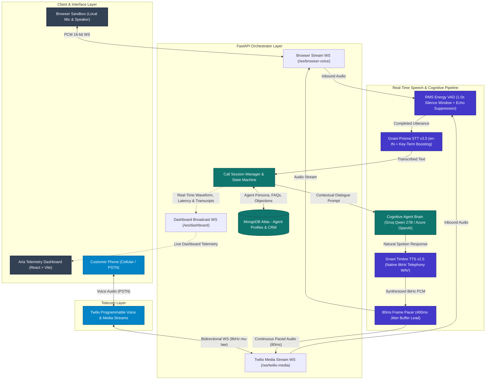

# 🎙️ Aria — Real-Time Autonomous AI Voice Sales & Support Agent

> **Production-grade, full-duplex conversational voice telephony agent powered by Twilio Bidirectional Media Streams, Gnani Prisma STT, Gnani Timbre TTS, and an adaptive Multi-Agent Cognitive Brain.**

---

## 🌟 Overview & System Architecture

Aria is not a standard turn-based chatbot or slow IVR. It is a full-duplex, low-latency conversational telephony agent engineered for natural phone calls, customer query handling, and automated outbound sales.

### System Architecture Diagram



---

---

## ⚡ Key Highlights & Engineering Choices

1. **Twilio Bidirectional Media Streams (`<Connect><Stream>`)**:
   Instead of ordinary Twilio `<Gather>` (which causes 3–5s delays and unnatural pauses), Aria streams audio over continuous WebSockets. Twilio streams raw 8kHz μ-law audio to our server, and our server streams synthesized 8kHz μ-law audio back into the call.
2. **Anti-Starvation 80ms Audio Pacing (400ms Lead Buffer)**:
   Streams synthesized voice in **80ms (640-byte)** blocks with a pre-filled **400ms jitter buffer lead**. Coupled with Windows 1ms multimedia timer locking (`timeBeginPeriod(1)`), Twilio's audio queue never starves, completely eliminating speech stuttering and mid-sentence pauses.
3. **Acoustic Echo Suppression & Tail-End Sync**:
   Suppresses incoming phone speaker echo while the AI is speaking so loudspeaker feedback does not trigger false interruptions. The server also synchronizes physical speaker playback completion before re-enabling microphone VAD, preventing clipped syllables.
4. **Snappy 1.0-Second Voice Activity & Silence Detection**:
   Distinguishes background noise from active speech using RMS energy analysis. Maintains a circular pre-roll buffer to prevent cutting off the first syllable, triggering utterance completion after **1.0 second of silence** for conversational turn-taking.
5. **Gnani Speech Intelligence**:
   - **STT**: Uses Gnani Prisma v3.0 locked to `en-IN` with **Dynamic Vocabulary Boosting** (`key_terms`) to transcribe brand and product names (*SmartSave+*, *Nova X5*, *NACH*, *Dimensity 7050*).
   - **TTS**: Uses Gnani Timbre v2.5 (`Nalini` / `Aryan`) generating native 8000 Hz telephony audio with ~280ms first-byte synthesis.
6. **Multi-Model Cognitive Engine (Groq Qwen 27B & Azure OpenAI)**:
   Powered by ultra-fast LLM inference (<350ms) via Groq with automatic failover to Azure OpenAI and a zero-downtime Agent-Aware Cognitive Engine.
7. **Dynamic Multi-Agent Profiles**:
   Hot-swap between distinct agent personas (e.g., *SmartSave+ Financial Advisor* vs. *Nova Mobile Technical Consultant*) on the fly via MongoDB. All responses are strictly grounded in the selected agent's profile, features, and approved FAQs.
8. **Live Telemetry & Dashboard**:
   Real-time single-page application with live audio waveform visualization, per-turn latency telemetry (STT, LLM, TTS), transcript deduplication, and automated post-call CRM insights.

---

## 🚀 Step-by-Step Run Instructions

Follow these steps in order to set up, launch, and use the application:

### Step 1: Setup `.env` Configuration
Ensure your `.env` file in the project root directory is populated with your API credentials:

```ini
# Twilio Programmable Voice
TWILIO_ACCOUNT_SID=your_account_sid
TWILIO_AUTH_TOKEN=your_auth_token
TWILIO_PHONE_NUMBER=+1xxxxxxxxxx

# Gnani Speech-to-Text & Text-to-Speech
GNANI_API_KEY=your_gnani_key
GNANI_BASE_URL=https://api.vachana.ai
GNANI_STT_MODEL=prisma-v3.0
GNANI_STT_LANGUAGE=en-IN
GNANI_TTS_VOICE=Nalini
GNANI_TTS_MODEL=timbre-v2.5
GNANI_TTS_LANGUAGE=en-IN

# LLM Configuration (Groq Qwen 27B for ultra-fast voice)
LLM_PROVIDER=auto
GROQ_API_KEY=your_groq_key
GROQ_MODEL=qwen/qwen3.8-27b

# Database Configuration (MongoDB Atlas)
MONGO_URI=mongodb+srv://...
MONGO_DB_NAME=sales_ai_agent

# Voice Pipeline Parameters (1.0s silence detection)
SILENCE_THRESHOLD_MS=1000
MIN_UTTERANCE_MS=300
VAD_ENERGY_THRESHOLD=200

# Public Host (Will be populated with your ngrok URL in Step 4)
PUBLIC_BASE_URL=https://your-ngrok-url.ngrok-free.app
```

---

### Step 2: Install Requirements (Backend & Frontend)

Open your terminal in the `Sales_Agent` root directory:

**1. Install Python Backend Dependencies:**
```bash
pip install -r backend/requirements.txt
```

**2. Install Frontend Dependencies:**
```bash
cd frontend
npm install
cd ..
```

---

### Step 3: Run the Backend Server

Start the FastAPI application and WebSockets engine:

```bash
# In Terminal 1 (from project root):
python run_server.py
```
*(Backend runs on `http://localhost:8000`)*

---

### Step 4: Start Ngrok & Set URL in `.env`

Expose port 8000 so Twilio telephony servers can reach your local media stream:

```bash
# In Terminal 2:
ngrok http 8000
```

1. Copy the public **Forwarding URL** displayed by ngrok (e.g. `https://3a6b-2409-40c1.ngrok-free.app`).
2. Paste it in your `.env` file:
   ```ini
   PUBLIC_BASE_URL=https://3a6b-2409-40c1.ngrok-free.app
   ```
*(Note: Aria also auto-detects active tunnels via `http://127.0.0.1:4040/api/tunnels` automatically).*

---

### Step 5: Run the Frontend UI

Start the Vite development server:

```bash
# In Terminal 3:
cd frontend
npm run dev
```
*(Frontend runs on `http://localhost:5173`)*

---

### Step 6: Open & Use the Site

1. Open your browser to **[http://localhost:5173](http://localhost:5173)**.
2. Select an Agent (e.g., *Nova Mobile* or *SmartSave+*).
3. Enter your phone number (e.g. `+919876543210`) or pick a saved lead.
4. Click **Start Outbound Call**!
   - Your phone will ring.
   - Answer the call to converse with the AI in real time.
   - The live waveform and transcript will stream directly on the dashboard.
   - *(Zero manual Twilio webhook setup required — Aria dynamically connects your number via API).*

---

## 🧪 Testing in Browser Sandbox (Without Twilio)

You can also test the full conversational AI locally using your computer microphone:
1. Open **[http://localhost:5173](http://localhost:5173)**.
2. Click **Browser Sandbox** (next to Start Outbound Call).
3. Allow microphone permissions and speak! The AI will answer in real time through your laptop speakers.
   - Voice activity detected in real-time on the audio waveform.
   - Silence detector triggers automatically after **1.0 second of silence**.
   - Gnani STT transcribes your speech.
   - The Cognitive Agent Brain generates a contextual 1–2 sentence response.
   - Gnani TTS speaks the answer back through your speakers smoothly.

---

## 📄 Solution Pitch & Executive Summary Document

A 1-page executive & technical pitch document is available in the repository:
- **1-Page PDF Document**: [`Aria_Solution_Pitch.pdf`](file:///c:/Users/yashv/Documents/Sales_Agent/Aria_Solution_Pitch.pdf)
- **Markdown Version**: [`Aria_Solution_Pitch.md`](file:///c:/Users/yashv/Documents/Sales_Agent/Aria_Solution_Pitch.md)
- **PDF Generation Script**: [`generate_pitch_pdf.py`](file:///c:/Users/yashv/Documents/Sales_Agent/generate_pitch_pdf.py)

---

## 📂 Project Directory Structure

```
Sales_Agent/
├── backend/
│   ├── app/
│   │   ├── main.py                  # FastAPI application & WebSocket routers (1ms timer lock)
│   │   ├── config.py                # Pydantic environment configuration
│   │   ├── database.py              # MongoDB async connection & agent seeds
│   │   ├── audio/
│   │   │   ├── codec.py             # μ-law <-> PCM, dynamic WAV header parsing, RMS VAD
│   │   │   ├── buffer.py            # Utterance audio buffer & pre-roll
│   │   │   └── resampler.py         # Sample rate resampler (8kHz)
│   │   ├── services/
│   │   │   ├── providers/
│   │   │   │   ├── base.py          # Abstract STT/TTS/LLM Provider interfaces
│   │   │   │   ├── stt_gnani.py     # Gnani Prisma v3.0 STT integration (en-IN)
│   │   │   │   ├── tts_gnani.py     # Gnani Timbre v2.5 TTS integration (8kHz)
│   │   │   │   └── llm_provider.py  # Groq Qwen 27B, Azure OpenAI & Agent Brain
│   │   │   ├── twilio_service.py    # Twilio REST API & TwiML generation
│   │   │   ├── silence_detector.py  # 1.0s Silence & Voice onset detector
│   │   │   ├── conversation_service.py # State machine, prompts, objection playbooks
│   │   │   └── call_session_manager.py # Call session lifecycle & telemetry
│   │   ├── api/
│   │   │   ├── calls.py             # Outbound dispatch, auto-ngrok detection, webhook
│   │   │   ├── customers.py         # Customer CRM CRUD
│   │   │   ├── agents.py            # Dynamic Agent Profile CRUD
│   │   │   ├── products.py          # Legacy Product CRUD
│   │   │   └── analytics.py         # Aggregated telemetry & benchmarks
│   │   ├── websocket/
│   │   │   ├── twilio_stream.py     # Twilio Media Streams 80ms paced bidirectional WS
│   │   │   └── browser_stream.py    # Browser microphone sandbox WS & dashboard WS
│   │   └── schemas/                 # Pydantic request/response models
│   └── requirements.txt
├── frontend/
│   ├── src/                         # React 18 + Vite modern dashboard
│   │   ├── App.jsx                  # Dial bar, live transcript, waveform canvas
│   │   └── index.css
│   └── index.html
├── tests/
│   ├── test_audio.py                # Audio codec unit tests
│   ├── test_silence_detector.py     # Silence detection & VAD unit tests
│   ├── test_conversation.py        # Sales conversation & state machine tests
│   └── test_llm.py                 # LLM provider unit tests
├── Aria_Solution_Pitch.pdf          # 1-Page printable technical solution pitch PDF
├── Aria_Solution_Pitch.md           # 1-Page solution pitch markdown document
├── generate_pitch_pdf.py            # Script to generate the 1-page PDF
├── run_server.py                    # Server launch script
├── .env                             # Environment variables
├── .env.example                     # Environment template
└── README.md
```
